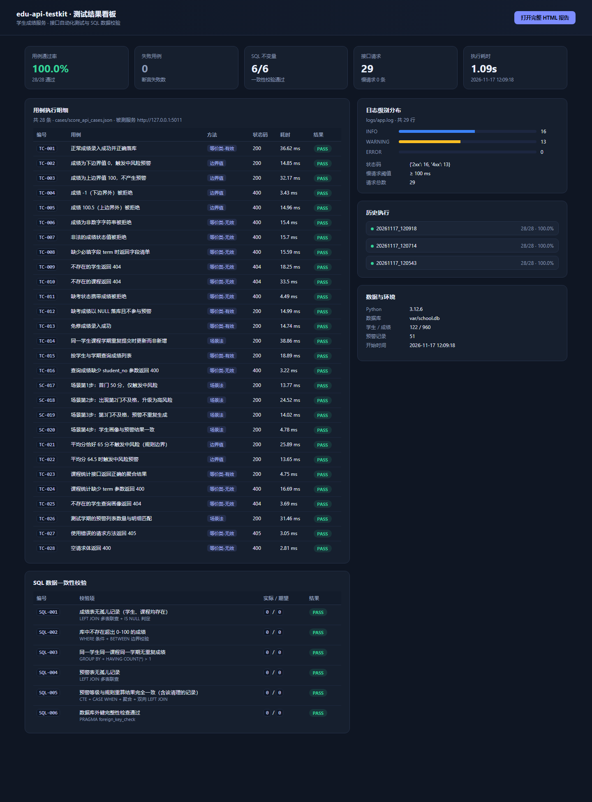

# edu-api-testkit · 学生成绩服务接口自动化测试与 SQL 数据校验

一个可以直接运行、可以截图展示的软件测试小项目：用 Flask + SQLite 实现一套「学生成绩与学业预警」服务，
再针对它编写 28 条接口自动化用例（等价类 / 边界值 / 场景法），每条用例都通过真实 HTTP 调用触发业务，
并用 SQL 从数据库反查、交叉校验写入结果，最终产出 HTML 测试报告、测试结果看板和日志分析结果。

> 面向「软件测试实习生」岗位的简历作品：重点展示 **测试用例设计方法 + SQL 数据校验 + 日志排查** 三项能力。

---

## 1. 项目简介

被测服务提供成绩录入、成绩查询、课程统计、学生画像、学业预警等接口；测试工具负责：

- 用固定随机种子生成可复现的模拟数据（122 名学生 / 8 门课程 / 960 条成绩）
- 启动真实 HTTP 服务，按顺序执行 28 条接口用例，断言状态码、响应 JSON 和数据库落库结果
- 执行 6 项全库 SQL 不变量校验（多表联查、聚合、子查询、CTE），发现跨接口的数据一致性问题
- 解析服务端日志，统计级别、状态码、慢请求分布
- 生成单文件 HTML 测试报告，并用 Flask 看板展示最新 / 历史执行结果

## 2. 岗位要求与项目对应关系

| 岗位要求 | 本项目的对应实现 |
| --- | --- |
| 掌握常用 SQL（多表联查、聚合、子查询），能独立完成数据校验 | `tool/checks.py` 中 12 个校验函数；用例写入后用 SQL 反查数据库；6 项全库不变量校验用 CTE + CASE WHEN 重算预警规则并与表数据双向比对 |
| Linux：查看日志、修改配置文件 | 服务端访问日志写入 `logs/app.log`；`tool/logscan.py` 支持按级别 / 状态码 / 路径 / 耗时 / 关键字过滤并汇总，README 第 8 节给出与 `grep`、`awk` 的对照命令 |
| 熟悉测试流程与规范，掌握等价类、边界值、场景法等用例设计方法 | `cases/score_api_cases.json` 中每条用例标注设计方法；覆盖有效/无效等价类、上下边界、规则边界和 4 步串联业务场景 |
| 细心、耐心、有逻辑 | 覆盖重复提交、缺考/免修、空请求体、错误方法、字段缺失、非法枚举值等容易被忽略的分支；所有断言失败都会输出“期望 vs 实际” |
| 计算机相关专业，会 Python / SQL | Python + Flask + SQLite + requests + unittest，全部代码可读、可运行 |

## 3. 技术栈

- Python 3.9+（本机实测 3.12.6）
- Flask 3.x：被测服务与结果看板
- SQLite：数据库（`sqlite3` 标准库，无需安装）
- requests：真实 HTTP 调用
- unittest：项目自检（当前环境未安装 pytest，按“依赖缺失用标准库替代”的原则实现）
- HTML + CSS：自包含测试报告与看板页面（无前端框架、无外部 CDN）

## 4. 项目结构

```text
edu-api-testkit/
├─ app/                      # 被测系统（SUT）
│  ├─ server.py              # Flask 接口：成绩录入/查询、课程统计、学生画像、预警、健康检查
│  ├─ rules.py               # 学业预警规则（挂科≥2门=high；平均分<65=medium）
│  └─ schema.sql             # 建表语句（唯一约束、CHECK 约束、外键、索引）
├─ data/
│  └─ generate_data.py       # 模拟数据生成（固定种子，可复现）
├─ cases/
│  ├─ score_api_cases.json   # 28 条接口用例，标注设计方法
│  └─ sql_suite.json         # 6 项全库 SQL 不变量校验
├─ tool/
│  ├─ runner.py              # 用例执行引擎（启动服务 → HTTP 调用 → SQL 校验 → 汇总）
│  ├─ checks.py              # 数据库校验函数注册表
│  ├─ report.py              # 单文件 HTML 报告生成
│  ├─ dashboard.py           # Flask 测试结果看板
│  ├─ logscan.py             # 日志分析 CLI（grep/awk 风格）
│  └─ cli.py                 # 统一命令入口
├─ tests/                    # 22 个 unittest 自检用例
├─ screenshots/              # 实际运行截图
├─ requirements.txt
└─ README.md
```

运行后会自动生成 `var/school.db`、`logs/app.log`、`reports/latest_result.json`、`reports/latest_report.html`
（这些运行时产物已加入 `.gitignore`，不提交到仓库）。

## 5. 运行步骤

```bash
# 1. 安装依赖（建议使用虚拟环境）
python -m venv .venv
# Windows: .venv\Scripts\activate    macOS/Linux: source .venv/bin/activate
pip install -r requirements.txt

# 2. 生成模拟数据（可选，执行 run 时会自动重建）
python -m data.generate_data

# 3. 执行全部接口用例：打印逐条结果，生成报告
python -m tool.cli run

# 4. 查看 HTML 报告（也可直接双击 reports/latest_report.html）
python -m tool.cli dashboard   # 打开 http://127.0.0.1:5002

# 5. 启动被测服务，手工调接口
python -m tool.cli serve       # 打开 http://127.0.0.1:5001/health

# 6. 日志分析
python -m tool.logscan --summary
python -m tool.logscan --level WARNING --limit 10
python -m tool.logscan --status 4xx
python -m tool.logscan --min-ms 100

# 7. 项目自检
python -m unittest discover -s tests -v
```

实测结果（本机 Windows 11 / Python 3.12.6）：

```text
执行完成：28/28 用例通过，SQL 校验 6/6 通过，总耗时 1.09s
22 个单元测试全部通过（Ran 22 tests ... OK）
```

## 6. 接口与测试设计

被测接口：

| 方法 | 路径 | 说明 |
| --- | --- | --- |
| POST | `/api/scores` | 成绩录入：校验必填字段、状态枚举、0–100 边界；重复提交按唯一键更新并重算预警 |
| GET | `/api/scores` | 按学生 + 学期查询成绩 |
| GET | `/api/stats/course/<code>` | 课程统计：人数、平均分、最高/最低分、及格率 |
| GET | `/api/students/<no>/profile` | 学生画像：总均分、不及格门数、按学期分组、最新预警 |
| GET | `/api/warnings` | 预警列表，可按学期过滤 |
| GET | `/health` | 健康检查（执行器用它判断服务就绪） |

用例设计方法分布（共 28 条）：

| 方法 | 数量 | 示例 |
| --- | --- | --- |
| 等价类-有效 | 5 | 正常分数 85 录入成功；按学生查询成绩；课程统计结果正确 |
| 等价类-无效 | 11 | `score=-1`、`score=100.5`、`score="abc"`、非法 status、缺字段、学生/课程不存在、缺考带分数、错误请求方法、空请求体 |
| 边界值 | 6 | 成绩 0 / 100 / -1 / 100.5；预警规则边界：平均分恰好 65 不预警、64.5 触发中风险 |
| 场景法 | 6 | 从 0 开始依次录入 50 → 55 → 45 分，验证预警从“无 → 中风险 → 高风险”、不重复生成，并与学生画像、预警列表交叉核对 |

用例文件示例（`cases/score_api_cases.json`）：

```json
{
  "id": "SC-018",
  "title": "场景第2步：出现第2门不及格，升级为高风险",
  "method_design": "场景法",
  "request": {"method": "POST", "path": "/api/scores",
              "json": {"student_no": "S9999", "course_code": "CS102",
                       "term": "2025-2026-3", "status": "normal", "score": 55}},
  "expect": {"status": 200, "json": {"warning": {"level": "high", "reason": "不及格 2 门"}}},
  "checks": [{"name": "warning_level",
              "params": {"student_no": "S9999", "term": "2025-2026-3"},
              "expect": "high"}]
}
```

## 7. SQL 数据校验

单条用例写入后立即用 SQL 校验（`tool/checks.py`）：

| 校验函数 | 用到的 SQL 能力 |
| --- | --- |
| `score_of` / `score_status` | `students JOIN scores JOIN courses` 多表联查 |
| `score_rows` | `COUNT(*)` 聚合，验证唯一约束与重复提交 |
| `warning_level` / `warning_count` | 子查询取学生 id 后再筛选预警 |
| `course_stats` | `AVG/MAX/MIN` + `SUM(CASE WHEN ...)` 统计及格率 |
| `warning_rule_mismatch` | CTE + `CASE WHEN` 用 SQL 重算预警规则，与 `warnings` 表双向比对 |

全部用例执行后运行 6 项全库不变量校验（期望违例数恒为 0）：

1. 成绩表孤儿记录（学生、课程是否存在）
2. 成绩是否超出 0–100
3. 同一学生 / 课程 / 学期是否重复
4. 预警表孤儿记录
5. 预警等级与规则重算结果是否一致（含应清理但未清理的预警）
6. `PRAGMA foreign_key_check` 外键完整性

## 8. 日志排查与 Linux 命令对照

`logs/app.log` 每行格式：

```text
2026-11-17 12:09:18 | INFO    | api | POST /api/scores -> 200 (10ms)
2026-11-17 12:09:18 | WARNING | api | POST /api/scores -> 400 (3ms)
```

| Linux 常规做法 | 本项目等价命令 |
| --- | --- |
| `grep '| ERROR' logs/app.log` | `python -m tool.logscan --level ERROR` |
| `grep '-> 4' logs/app.log` | `python -m tool.logscan --status 4xx` |
| `grep -c 'POST /api/scores' logs/app.log` | `python -m tool.logscan --path /api/scores --summary` |
| `awk -F'|' '{print $2}' logs/app.log \| sort \| uniq -c` | `python -m tool.logscan --summary`（输出级别 / 状态码分布） |
| `grep '(1[0-9][0-9]ms)' logs/app.log` | `python -m tool.logscan --min-ms 100` |

## 9. 模拟数据来源与生成逻辑

- 全部数据由 `data/generate_data.py` 生成，**不含任何真实学生信息，也不抓取外部数据**。
- 随机种子固定为 42，重复执行得到完全一致的数据库，保证测试结果可复现。
- 120 名普通学生 + 2 名测试专用学生（S9999 / S9998，无初始成绩，供场景法从零构造预警）。
- 8 门课程、2 个学期；每人每学期随机修 4 门课。
- 成绩服从 N(72, 13) 并截断到 0–100 后取整；约 6% 记为缺考、6% 记为免修。
- 生成后按预警规则回填 `warnings` 表，保证初始数据自洽（初始 51 条预警）。
- 所有写操作用例集中在测试学期 `2025-2026-3`，与种子数据的两个学期隔离，互不干扰。

## 10. 运行截图

1）真实终端执行输出（28/28 通过）：


2）HTML 测试报告（`reports/latest_report.html`）：


3）测试结果看板（`python -m tool.cli dashboard`，读取最新结果与历史执行记录）：



4）日志分析输出（`python -m tool.logscan --summary`）：


> 说明：第 1、4 张截图是真实终端输出的渲染快照（命令见图片底部），第 2、3 张是浏览器实际打开页面后的截图。

## 11. 可写进简历的一句话摘要

> 基于 Flask + SQLite 搭建学生成绩预警服务，使用 Python 编写 28 条接口自动化用例（等价类 / 边界值 / 场景法），
> 结合多表联查、聚合、子查询等 SQL 对落库数据做交叉校验，输出 HTML 测试报告与结果看板，并配套日志分析工具定位异常请求。

## 12. 已知限制

- 单机 SQLite、单进程 Flask 开发服务器，未做并发与性能压测。
- 未接入 CI、未统计代码覆盖率（用例覆盖按接口分支人工梳理）。
- 服务无鉴权，仅用于本地学习与作品展示。
- 当前环境未安装 pytest，自检使用标准库 `unittest`；如需 pytest 可直接安装后补充用例。
- 代码规模约 1.9k 行，其中核心 Python 逻辑约 1.2k 行，HTML/CSS 报告模板约 0.5k 行，单元测试约 0.3k 行。
