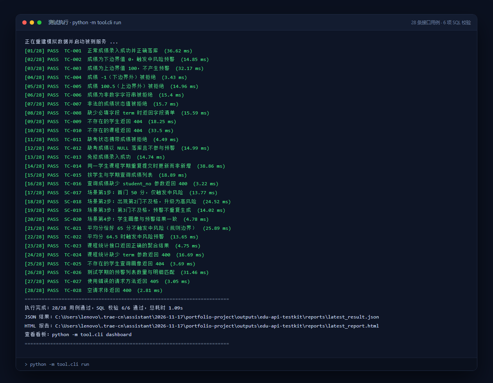
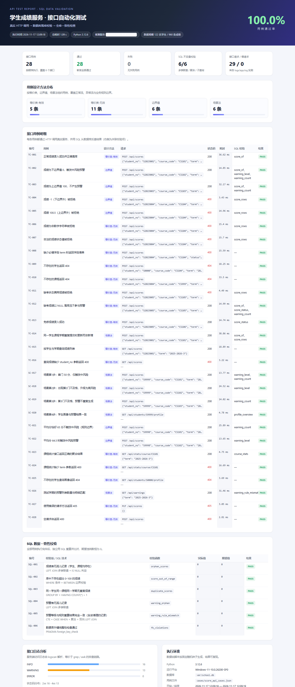
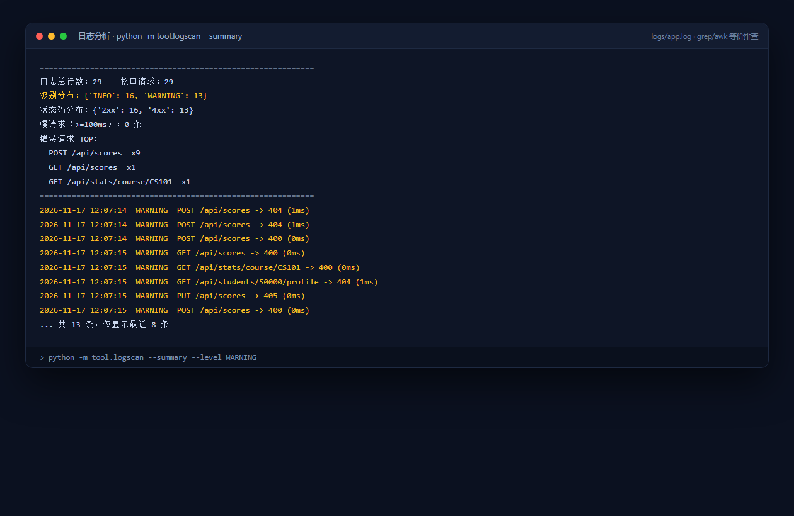

# edu-api-testkit · 学生成绩服务接口自动化测试与 SQL 数据校验

一个可在本地运行的接口测试练习项目：先用 Flask + SQLite 实现成绩与学业预警服务，再对其编写接口用例，在本地启动服务后用 `requests` 调用，并用 SQL 回数据库核对结果。项目同时输出 HTML 测试报告、结果看板和日志统计。

## 1. 项目简介

被测服务提供成绩录入、成绩查询、课程统计、学生画像、学业预警等接口；测试工具负责：

- 用固定随机种子生成可复现的模拟数据（一百多名学生、8 门课程、两个学期）
- 在本地启动 HTTP 服务，按顺序执行二十多条接口用例，断言状态码、响应 JSON 和数据库落库结果
- 执行几项全库 SQL 检查（多表联查、聚合、子查询、CTE），发现跨接口的数据一致性问题
- 解析服务端日志，统计级别、状态码、慢请求分布
- 生成单文件 HTML 测试报告，并用 Flask 看板展示最新 / 历史执行结果

技术栈：

- Python 3.9+（本机实测 3.12.6）
- Flask 3.x：被测服务与结果看板
- SQLite：数据库（`sqlite3` 标准库，无需安装）
- requests：在本地启动服务后发起 HTTP 调用
- unittest：项目自检（当前环境未安装 pytest，按"依赖缺失用标准库替代"的原则实现）
- HTML + CSS：自包含测试报告与看板页面（无前端框架、无外部 CDN）

## 2. 系统结构

项目分为**被测服务**和**测试工具**两部分：前者提供接口，后者负责调用、断言、SQL 校验和产出报告。

### 2.1 被测服务（`app/`）

服务对外提供 6 个接口：

| 方法 | 路径 | 说明 |
| --- | --- | --- |
| POST | `/api/scores` | 成绩录入：校验必填字段、状态枚举、0–100 边界；重复提交按唯一键更新并重算预警 |
| GET | `/api/scores` | 按学生 + 学期查询成绩 |
| GET | `/api/stats/course/<code>` | 课程统计：人数、平均分、最高/最低分、及格率 |
| GET | `/api/students/<no>/profile` | 学生画像：总均分、不及格门数、按学期分组、最新预警 |
| GET | `/api/warnings` | 预警列表，可按学期过滤 |
| GET | `/health` | 健康检查（执行器用它判断服务是否就绪） |

学业预警规则（`app/rules.py`）：

- 不及格门数 ≥ 2 → `high`（高风险）
- 否则学期平均分 < 65 → `medium`（中风险）
- 其余情况不产生预警

成绩每次变更后按规则重算，重算时先删除旧的预警记录再写入新的，保证同一学生同一学期最多一条预警。

数据库（`app/schema.sql`）共 4 张表：学生、课程、成绩、预警，包含唯一约束、`CHECK` 约束、外键和索引。

### 2.2 测试工具（`tool/`）

| 文件 | 职责 |
| --- | --- |
| `runner.py` | 用例执行引擎：启动服务 → 逐条发请求 → 断言 → SQL 校验 → 汇总 |
| `checks.py` | 数据库校验函数注册表，供用例按名字调用 |
| `report.py` | 把执行结果渲染成单文件 HTML 报告 |
| `dashboard.py` | Flask 看板，读取最新结果与历史记录 |
| `logscan.py` | 日志分析命令行工具，按级别 / 状态码 / 路径 / 耗时过滤并汇总 |
| `cli.py` | 统一命令入口：`seed` / `run` / `serve` / `dashboard` |

执行一条用例的流程是固定的四步：

1. 按用例里的 `request` 发起 HTTP 请求；
2. 断言状态码、响应 JSON 的子集和错误文案；
3. 按用例里的 `checks` 连接数据库，执行对应校验函数并比对期望值；
4. 记录耗时；任何一步不一致，都会把"期望 vs 实际"写进结果。

### 2.3 模拟数据（`data/`）

- 全部数据由 `data/generate_data.py` 生成，**不含任何真实学生信息，也不抓取外部数据**。
- 随机种子固定为 42，重复执行得到完全一致的数据库，保证测试结果可复现。
- 120 名普通学生 + 2 名测试专用学生（S9999 / S9998，无初始成绩，供场景法从零构造预警）。
- 8 门课程、2 个学期；每人每学期随机修 4 门课。
- 成绩服从 N(72, 13) 并截断到 0–100 后取整；约 6% 记为缺考、6% 记为免修。
- 生成后按预警规则回填 `warnings` 表，保证初始数据自洽（初始 51 条预警）。
- 所有写操作用例集中在测试学期 `2025-2026-3`，与种子数据的两个学期隔离，互不干扰。

## 3. 测试设计

### 3.1 用例如何组织

用例写在 `cases/score_api_cases.json` 里，每条是一小段 JSON，包含五块：

1. `id` / `title`：编号和一句话说明；
2. `method_design`：使用了哪种用例设计方法；
3. `request`：请求方法、路径、参数或请求体；
4. `expect`：期望的状态码、响应字段、错误文案；
5. `checks`：执行后用哪条 SQL 校验函数去库里核对什么值。

用例按数组顺序执行，写操作集中在测试学期 `2025-2026-3`；以 `SC` 开头的用例是场景法，后一步依赖前一步写入的数据。

### 3.2 用例方法分布

共二十多条，按设计方法分布如下：

| 方法 | 数量 | 示例 |
| --- | --- | --- |
| 等价类-有效 | 5 | 正常分数 85 录入成功；按学生查询成绩；课程统计结果正确 |
| 等价类-无效 | 11 | `score=-1`、`score=100.5`、`score="abc"`、非法 status、缺字段、学生/课程不存在、缺考带分数、错误请求方法、空请求体 |
| 边界值 | 6 | 成绩 0 / 100 / -1 / 100.5；预警规则边界：平均分恰好 65 不预警、64.5 触发中风险 |
| 场景法 | 6 | 从 0 开始依次录入 50 → 55 → 45 分，验证预警从"无 → 中风险 → 高风险"、不重复生成，并与学生画像、预警列表交叉核对 |

### 3.3 几条代表性用例

**① 无效等价类：成绩传字符串 `"abc"`（TC-006）**

分数按类型分为"数字"和"非数字"两组，`"abc"` 是后者的代表。用例期望返回 400，错误信息包含"数字"，并用 SQL 确认这门课没有写入任何记录。

**② 边界值：平均分 65 与 64.5（TC-021 / TC-022）**

规则是"平均分小于 65 才预警"，所以 65 是"不预警"，64.999 才预警。测试用同一个学生先录 65 分（不产生预警），再录 64 分（两门平均 64.5，产生中风险），专门用于发现 `<` 和 `<=` 写反的问题。

**③ 场景法：预警从无到高风险（SC-017 ~ SC-020）**

场景法验证的是一串有先后关系的操作：

| 步骤 | 操作 | 期望 | 验证点 |
| --- | --- | --- | --- |
| SC-017 | 录 CS101 = 50 | 中风险 | 第一门不及格，均分 50 < 65 |
| SC-018 | 录 CS102 = 55 | 高风险，原因"不及格 2 门" | 不及格门数到 2，规则切换 |
| SC-019 | 录 CS103 = 45 | 高风险，且预警条数为 1 | 重复触发时不重复写入预警 |
| SC-020 | 查学生画像 | 3 门、均分 50、不及格 3 门、高风险 | 画像接口与预警表结论一致 |

用例片段：

```json
{
  "id": "SC-018",
  "title": "场景第2步：出现第2门不及格，升级为高风险",
  "method_design": "场景法",
  "request": {"method": "POST", "path": "/api/scores",
              "json": {"student_no": "S9999", "course_code": "CS102",
                       "term": "2025-2026-3", "status": "normal", "score": 55}},
  "expect": {"status": 200, "json": {"warning": {"level": "high", "reason": "不及格 2 门"}}},
  "checks": [{"name": "warning_level",
              "params": {"student_no": "S9999", "term": "2025-2026-3"},
              "expect": "high"}]
}
```

## 4. SQL 数据校验

单条用例写入后立即用 SQL 校验（`tool/checks.py`，十来个校验函数）：

| 校验函数 | 用到的 SQL 能力 |
| --- | --- |
| `score_of` / `score_status` | `students JOIN scores JOIN courses` 多表联查，确认写入值与状态 |
| `score_rows` | `COUNT(*)` 聚合，验证唯一约束与重复提交 |
| `warning_level` / `warning_count` | 子查询取学生 id 后再筛选预警，确认等级和条数 |
| `course_stats` | `AVG/MAX/MIN` + `SUM(CASE WHEN ...)` 统计及格率，与接口返回值交叉比对 |
| `warning_rule_mismatch` | CTE + `CASE WHEN` 用 SQL 重算预警规则，与 `warnings` 表双向比对 |

`warning_rule_mismatch` 值得单独说明：它先用 `WITH` 把每个学生每学期的成绩聚合成"总门数、不及格门数、平均分"，再用 `CASE WHEN` 按同样的规则算出"应该是什么等级"，最后用两个方向的 `LEFT JOIN` 找出两类问题——等级算错的，以及该清理却没清理的多余预警。

全部用例执行后运行几项全库检查（期望违例数恒为 0）：

1. 成绩表孤儿记录（学生、课程是否存在）
2. 成绩是否超出 0–100
3. 同一学生 / 课程 / 学期是否重复
4. 预警表孤儿记录
5. 预警等级与规则重算结果是否一致（含应清理但未清理的预警）
6. `PRAGMA foreign_key_check` 外键完整性

## 5. 日志分析

被测服务把每个请求写进 `logs/app.log`，每行格式：

```text
2026-11-17 12:09:18 | INFO    | api | POST /api/scores -> 200 (10ms)
2026-11-17 12:09:18 | WARNING | api | POST /api/scores -> 400 (3ms)
```

`tool/logscan.py` 解析这个格式，支持按级别、状态码、路径、耗时、关键字过滤并汇总。它做的事在 Linux 上通常由 `grep`、`awk` 完成：

| Linux 常规做法 | 本项目等价命令 |
| --- | --- |
| `grep '| ERROR' logs/app.log` | `python -m tool.logscan --level ERROR` |
| `grep '-> 4' logs/app.log` | `python -m tool.logscan --status 4xx` |
| `grep -c 'POST /api/scores' logs/app.log` | `python -m tool.logscan --path /api/scores --summary` |
| `awk -F'|' '{print $2}' logs/app.log \| sort \| uniq -c` | `python -m tool.logscan --summary`（输出级别 / 状态码分布） |
| `grep '(1[0-9][0-9]ms)' logs/app.log` | `python -m tool.logscan --min-ms 100` |

## 6. 运行方式与结果

### 6.1 运行步骤

```bash
# 1. 安装依赖（建议使用虚拟环境）
python -m venv .venv
# Windows: .venv\Scripts\activate    macOS/Linux: source .venv/bin/activate
pip install -r requirements.txt

# 2. 生成模拟数据（可选，执行 run 时会自动重建）
python -m data.generate_data

# 3. 执行全部接口用例：打印逐条结果，生成报告
python -m tool.cli run

# 4. 查看 HTML 报告（也可直接双击 reports/latest_report.html）
python -m tool.cli dashboard   # 打开 http://127.0.0.1:5002

# 5. 启动被测服务，手工调接口
python -m tool.cli serve       # 打开 http://127.0.0.1:5001/health

# 6. 日志分析
python -m tool.logscan --summary
python -m tool.logscan --level WARNING --limit 10
python -m tool.logscan --status 4xx
python -m tool.logscan --min-ms 100

# 7. 项目自检
python -m unittest discover -s tests -v
```

### 6.2 实测结果

本机 Windows 11 / Python 3.12.6 下，全部接口用例与 SQL 检查通过，二十多个单元自检用例通过（`Ran ... tests ... OK`）。

### 6.3 运行截图

1）终端执行输出（全部用例通过）：



2）HTML 测试报告（`reports/latest_report.html`）：



3）测试结果看板（`python -m tool.cli dashboard`，读取最新结果与历史执行记录）：


4）日志分析输出（`python -m tool.logscan --summary`）：



> 说明：第 1、4 张截图是终端输出的渲染快照（命令见图片底部），第 2、3 张是浏览器实际打开页面后的截图。

## 7. 目录结构

```text
edu-api-testkit/
├─ app/                      # 被测服务（SUT）
│  ├─ server.py              # Flask 接口：成绩录入/查询、课程统计、学生画像、预警、健康检查
│  ├─ rules.py               # 学业预警规则（挂科≥2门=high；平均分<65=medium）
│  └─ schema.sql             # 建表语句（唯一约束、CHECK 约束、外键、索引）
├─ data/
│  └─ generate_data.py       # 模拟数据生成（固定种子，可复现）
├─ cases/
│  ├─ score_api_cases.json   # 接口用例，标注设计方法
│  └─ sql_suite.json         # 全库 SQL 检查项
├─ tool/
│  ├─ runner.py              # 用例执行引擎（启动服务 → HTTP 调用 → SQL 校验 → 汇总）
│  ├─ checks.py              # 数据库校验函数注册表
│  ├─ report.py              # 单文件 HTML 报告生成
│  ├─ dashboard.py           # Flask 测试结果看板
│  ├─ logscan.py             # 日志分析 CLI（grep/awk 风格）
│  └─ cli.py                 # 统一命令入口
├─ tests/                    # unittest 自检用例
├─ screenshots/              # 运行截图
├─ requirements.txt
└─ README.md
```

运行后会自动生成 `var/school.db`、`logs/app.log`、`reports/latest_result.json`、`reports/latest_report.html`（这些运行时产物已加入 `.gitignore`，不提交到仓库）。

## 8. 已知限制

- 单机 SQLite、单进程 Flask 开发服务器，未做并发与性能压测。
- 未接入 CI、未统计代码覆盖率（用例覆盖按接口分支人工梳理）。
- 服务无鉴权，仅用于本地学习与练习。
- 当前环境未安装 pytest，自检使用标准库 `unittest`；如需 pytest 可直接安装后补充用例。
- 代码规模不大，核心 Python 逻辑一千行左右，另外有一部分是 HTML/CSS 报告模板。
